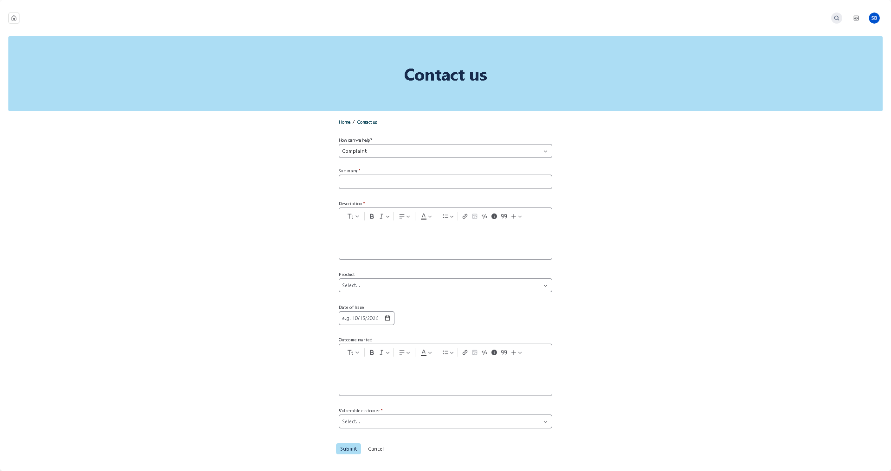
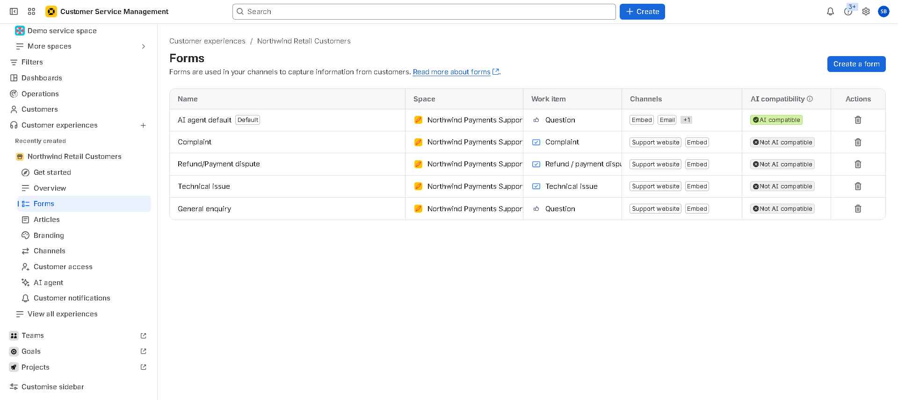
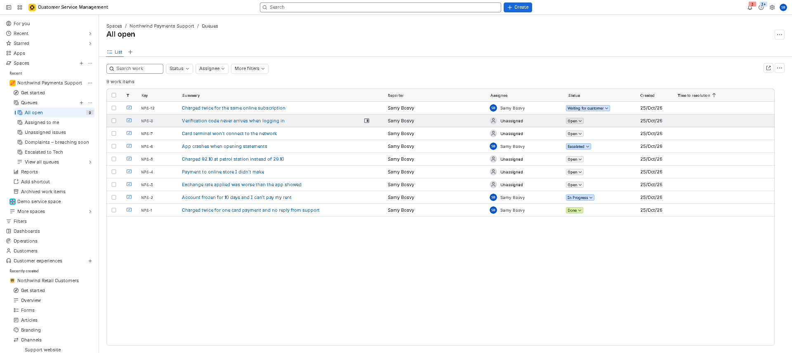
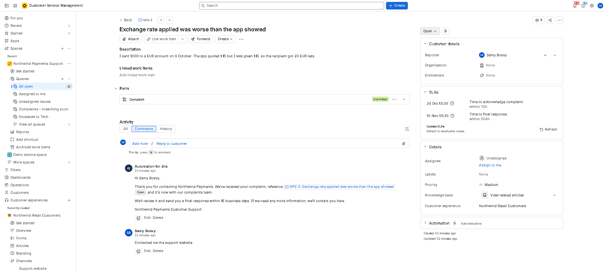
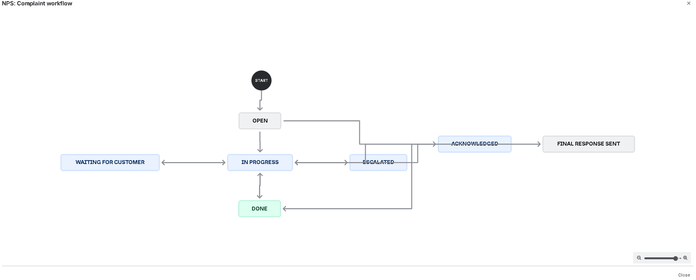
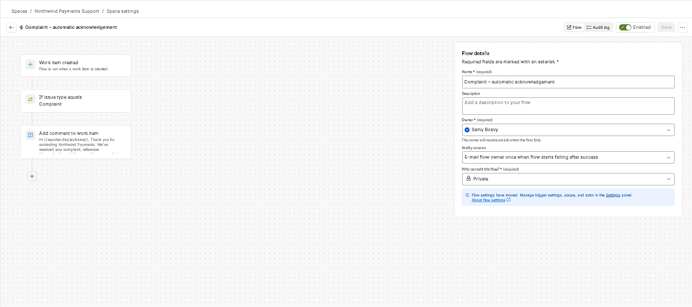
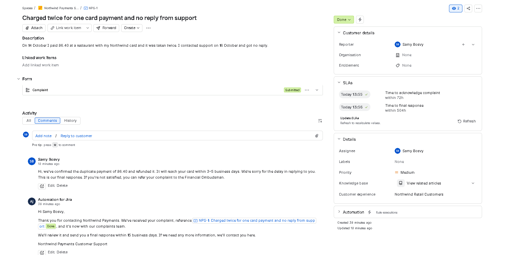

# Northwind Payments Support Desk

A customer support desk for a fictional fintech, built in Atlassian Customer Service Management (Jira Service Management family).

It's modelled on the EU/UK complaints process I ran as Complaints Manager at Square/Block, widened into a full support desk covering customer service, technical support and regulated complaints handling.

> Northwind Payments is an invented brand. All tickets and customers are fictional.

**New: [Zendesk AI layer](zendesk-ai/README.md).** The same desk rebuilt on Zendesk with a customer-facing AI agent, AI triage and routing, and an agent copilot that follows a written procedure.

## The business problem

A payments company gets very different contacts through one front door: quick questions, technical faults, payment disputes and formal complaints. They need different fields, different routes and different deadlines. Complaints in particular carry regulatory deadlines (PSD2: final response within 15 business days for payment complaints). This desk separates them at intake so each one follows the right process and is tracked against the right clock.

## Design

### Request types and intake fields

| Request type | Fields |
|---|---|
| General enquiry | Summary, Description |
| Technical issue | Summary, Platform (Web / iOS / Android / Card terminal), Error message, Steps to reproduce |
| Refund / payment dispute | Summary, Transaction ID, Amount, Transaction date, Reason (Not received / Duplicate / Unauthorised / Wrong amount) |
| Complaint | Summary, Description, Product (Card payments / Account / Transfers / Card terminal / Other), Date of issue, Outcome wanted, Vulnerable customer (required) |

### Workflows

- **Complaint** has its own workflow: Open → Acknowledged → In Progress → Final Response Sent → Done, with Waiting for customer and Escalated available along the way.
- **Technical issue, Refund / payment dispute and General enquiry** use the default service workflow: Open → In Progress → Waiting for customer / Escalated → Done.

### SLA targets

| Request type | Target |
|---|---|
| Complaint | Acknowledge within 3 days; final response within 21 calendar days (15 business days, PSD2) |
| Technical issue | First response within 4 hours |
| Refund / dispute | First response within 24 hours |
| General enquiry | First response within 8 hours |

### Queues

- **Complaints – breaching soon:** complaints close to an SLA breach. Empty means nothing is at risk.
- **Escalated to Tech:** technical issues handed to engineering.
- **Refunds awaiting evidence:** disputes waiting on the customer.
- Plus the default All open, Assigned to me and Unassigned queues.

### Automation

**Complaint – automatic acknowledgement**
- Trigger: work item created
- Condition: issue type equals Complaint
- Action: comment to the customer confirming receipt, their reference number and the 15-business-day final response commitment, using smart values for the customer's name and ticket key

## Testing

12 test tickets submitted through the customer portal (3 of each request type) and worked through the queue as an agent would:

- One complaint taken end to end: acknowledged automatically, investigated, final response sent with ombudsman referral rights, closed with both SLAs met.
- One vulnerable-customer complaint (wages frozen, rent due) set to Highest priority with an internal escalation note.
- A technical issue escalated to engineering, a refund dispute moved to Waiting for customer pending evidence, and three general enquiries answered and resolved.
- The remaining tickets left open so their SLA timers stay live.

## What I learned

- **Test with real submissions.** The Product dropdown had no options configured, which only showed up when submitting a test complaint. Options for a select field are set in the field's context in Jira admin, not in the form.
- **Calendars matter for regulatory SLAs.** This site only has a 24/7 calendar, so business-day deadlines are set as calendar-day equivalents. In production I'd use a business-hours calendar.
- **Known issue:** the Done status doesn't set a resolution, so closed complaints still appear in the All open queue. The fix is a resolution on the Done transition.

## Status

- [x] Site and "Northwind Payments Support" space created
- [x] Four customer-facing support forms built
- [x] Custom work types created (Complaint, Technical issue, Refund / payment dispute) and added to the space
- [x] Forms linked to their work types
- [x] Custom Complaint workflow
- [x] SLA timers
- [x] Queues
- [x] Automation rule
- [x] 12 test tickets submitted through the customer portal and worked through the queue
- [x] Screenshots

## Build log

### Week 1 (8–15 Oct 2026)
Set up the site and space, built the four support forms with their intake fields, created the three custom work types at site level, added them to the space and linked each form to its work type. Moved the new work types onto the main workflow, built the custom Complaint workflow, configured the four SLA targets and created three queues filtered with JQL.

### 25 Oct 2026
Built the Complaint acknowledgement automation. Added the missing Product dropdown options after a test submission exposed them. Submitted 12 test tickets through the portal, worked them through the queue (closed complaint, vulnerable-customer escalation, tech escalation, refund awaiting evidence, resolved enquiries) and took screenshots.

## Screenshots

**Customer portal: complaint intake form** (with mandatory vulnerable-customer flag)

**Forms routed to their work types**

**All open queue**

**SLA timers and automatic acknowledgement on a new complaint**

**Complaint workflow**

**Acknowledgement automation rule**

**Completed complaint: final response sent, both SLAs met**

## Tools

Atlassian Customer Service Management (Jira Service Management family), Free plan.

Zendesk Suite Professional (trial) for the [Zendesk AI layer](zendesk-ai/README.md).
