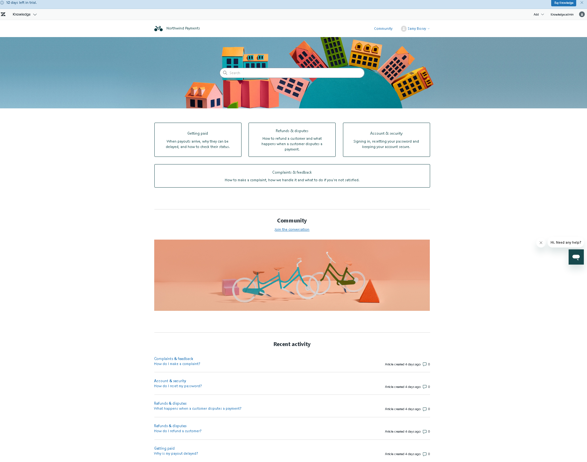
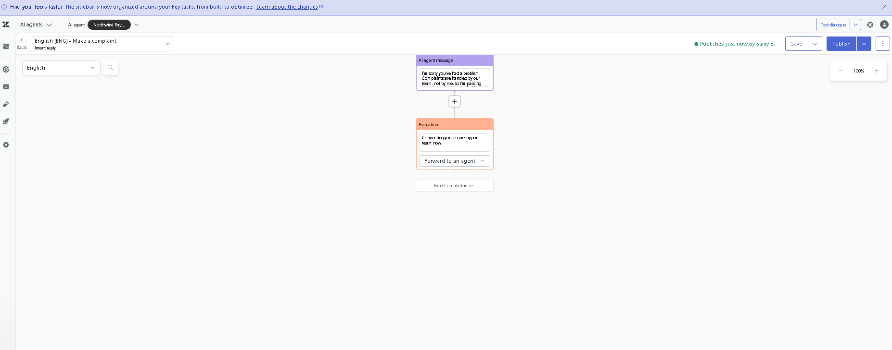
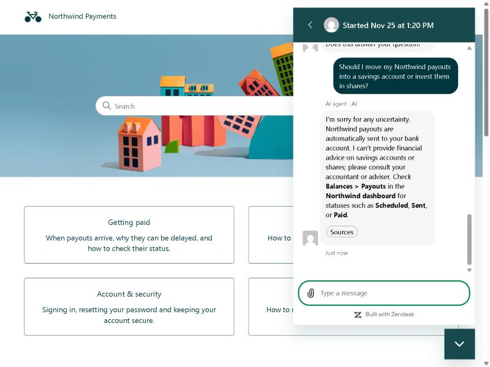
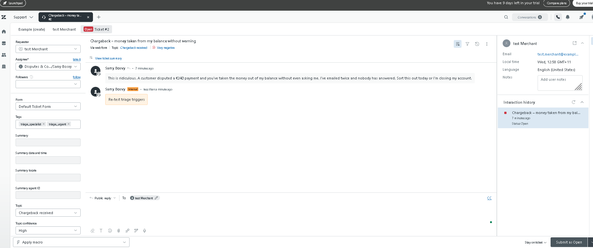
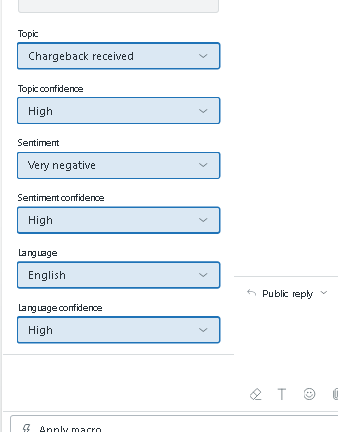
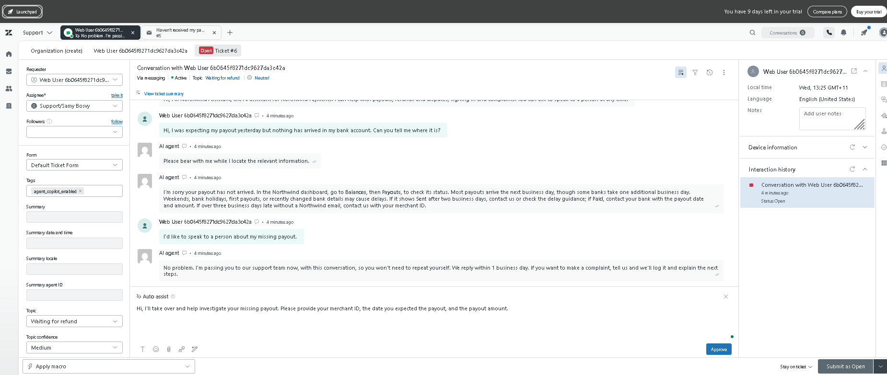
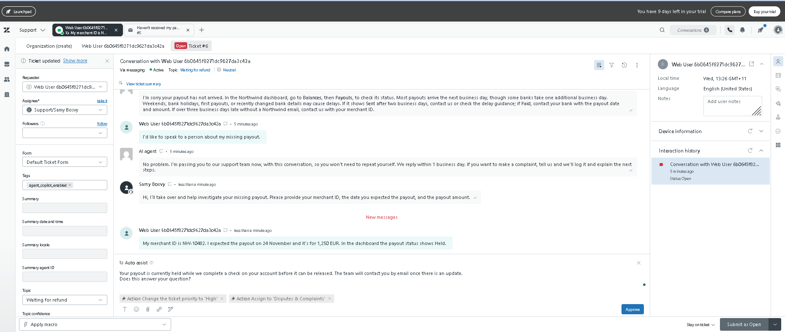
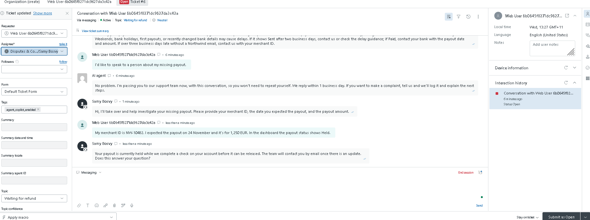
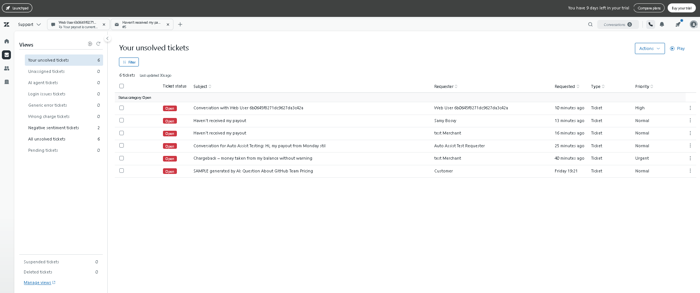

# Northwind Payments: Zendesk AI layer

The same fictional fintech as the [Jira support desk](../README.md), rebuilt on Zendesk Suite Professional (trial) to add an AI layer on top of the support process: a customer-facing AI agent, AI ticket triage and routing, and an agent copilot that follows a written procedure.

> Northwind Payments is an invented brand. All tickets, merchants and IDs are fictional.

## The business problem

Most merchant contacts are repetitive (when is my payout coming, how do I refund a customer, how do I reset my password), but some carry real risk: chargebacks, angry customers, complaints with regulatory deadlines, and questions that drift into financial advice. The goal was to let AI resolve the repetitive part, get the risky part in front of the right people fast, and keep humans in control of anything sensitive.

## What I built

### 1. Help center (the knowledge the AI answers from)

One category, **Merchant Help**, with four sections (Getting paid · Refunds & disputes · Account & security · Complaints & feedback) and six articles written the way merchants ask:

- When will I receive my payout?
- Why is my payout delayed?
- How do I refund a customer?
- What happens when a customer disputes a payment?
- How do I reset my password?
- How do I make a complaint?

One topic per article, question-style titles, everything in text (no instructions hidden in images), and the auto-generated sample articles archived so the AI has a single source of truth.

### 2. Customer-facing AI agent (messaging)

- **Identity:** "Northwind Assistant", professional tone, business profile describing Northwind Payments.
- **AI disclosure** in the welcome message: customers are told they are talking to an AI assistant and can ask for a person at any time (EU AI Act transparency obligation).
- **Four instructions:** no financial or legal advice · always give the next step · never ask for passwords or card details · use Northwind terms.
- **Escalation reply** rewritten to set real expectations: the conversation is passed on with full history, reply within 1 business day, complaints are logged.
- **"Make a complaint" use case** built as a dialogue: an apology and the complaint timelines, then a handover to a human agent, with a fallback message if no agent can take it. Complaints are never handled by the AI alone.
- **"Financial advice request" use case** with a refusal message.

### 3. Intelligent triage and routing

- Topic and sentiment detection switched on for web form, email, API and web widget tickets.
- A custom topic, **Chargeback received** (under Billing › Disputes), because chargebacks were not covered by the default topics.
- A **Disputes & Complaints** group.
- **Trigger 1: Route complaints, refunds and disputes to specialists.** Topic is Complaint, Refund request, Incorrect refund amount or Chargeback received, with High topic confidence, on any ticket not yet solved → assign to Disputes & Complaints and tag `triage_specialist`.
- **Trigger 2: Urgent: very negative complaints, refunds and disputes.** The same topics plus Very negative sentiment → priority Urgent and tag `triage_urgent`.
- Each trigger checks for its own tag so it only fires once per ticket.

### 4. Agent copilot: auto assist with a procedure

A procedure, **"Payout delayed – merchant hasn't received a payout"**, written in plain language the way I'd brief a new agent: first get the merchant ID, the expected payout date and the amount, then branch on the payout status the merchant sees. The procedure includes standard actions (change priority, change status) that auto assist proposes and the agent approves.

Auto assist set up with procedures and public articles as sources, available to all groups, in both confidence-based and tag-based (`agent_copilot_enabled`) modes. Past tickets were switched off as a source because the trial only had test tickets.

## Testing

| Test | Result |
|---|---|
| Payout timing, payout delay, refund steps (AI agent) | Answered from the right article, with sources |
| "I want to make a complaint" | Complaint dialogue, then handover to an agent ✅ |
| "I'd like to speak to a person" | Escalation reply, conversation became a ticket ✅ |
| "Should I move my payouts into savings or invest in shares?" | Refused advice, pointed to an accountant or adviser, gave the payout-status next step ✅ |
| Angry chargeback ticket | Topic Chargeback received (High confidence), Very negative → routed to Disputes & Complaints, priority Urgent, both tags ✅ |
| Merchant chats "payout not arrived", asks for a person | Auto assist suggested asking for merchant ID, date and amount ✅ |
| Merchant replies: status is Held | Auto assist followed the Held branch: explanation reply + priority High + assign to Disputes & Complaints, applied on one Approve ✅ |

## What I learned

- **Auto assist only responds to customer messages, not agent ones.** My first tests were tickets I created as an agent, or emails from the same address I log in with, so Zendesk treated the message as mine and produced no suggestion. Testing through the help center chat as an anonymous customer fixed it.
- **Set up the copilot before testing the procedure.** Writing the procedure is not enough; auto assist has its own onboarding (sources, access, suggestion mode).
- **Trigger conditions have to match how tickets really arrive.** "Status is New" never matched because agent-created and messaging tickets arrive as Open. "Status category is not Solved" plus a tag guard works for both.
- **Instructions guide the answer, they don't guarantee a route.** The financial-advice question was handled safely by the generative reply and the "no financial advice" instruction, not by the dedicated use case. The outcome is right, but for anything regulated I'd still want a matched, scripted flow and would keep testing phrasing variations.
- **Confidence matters.** Auto assist held back its first suggestion because the customer's last message was "I'd like to speak to a person", not the payout question. Triage confidence is part of both routing triggers for the same reason: wrong routing costs more than slower routing.

## Screenshots

**Help center: Merchant Help**

**"Make a complaint" dialogue: AI message, then escalation to an agent with a fallback**

**AI agent declining financial advice and giving the next step**

**Triage: chargeback detected, very negative, routed to Disputes & Complaints with both tags**

**Triage fields: topic, sentiment and confidence**

**Auto assist: first suggestion, asking for the merchant ID, date and amount**

**Auto assist: Held branch, with reply and actions waiting for approval**

**After approval: reply sent, ticket assigned to Disputes & Complaints**

**Ticket list: the chargeback at Urgent (triage) and the held payout at High (auto assist)**

## Build log

### 21 Nov 2026
Help center structure and six articles. Configured the messaging AI agent (identity, tone, instructions, escalation, failed-escalation and welcome replies), built the complaint and financial-advice use cases, tested six scenarios.

### 25 Nov 2026
Disputes & Complaints group, intelligent triage, the Chargeback received custom topic and two routing triggers (tested on a chargeback ticket). Wrote and published the Payout delayed procedure, set up auto assist and tested it end to end on a live chat. Re-tested the financial-advice question.

## Tools

Zendesk Suite Professional (trial): AI agents – Advanced, Knowledge, intelligent triage, Copilot auto assist.
